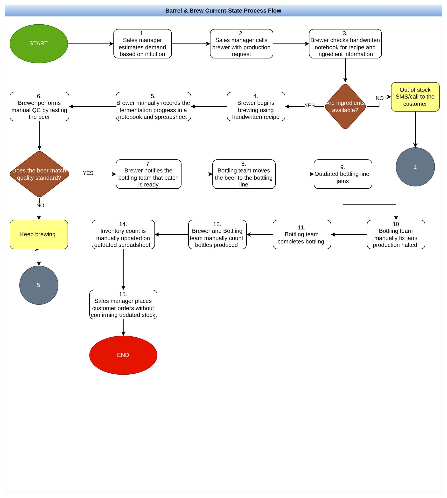
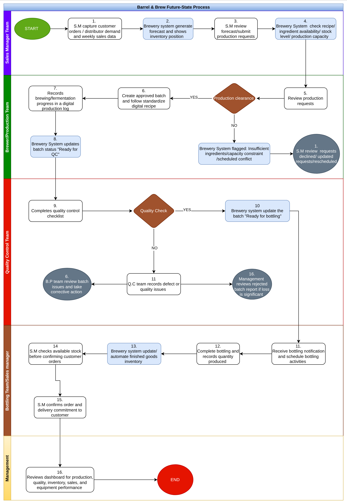
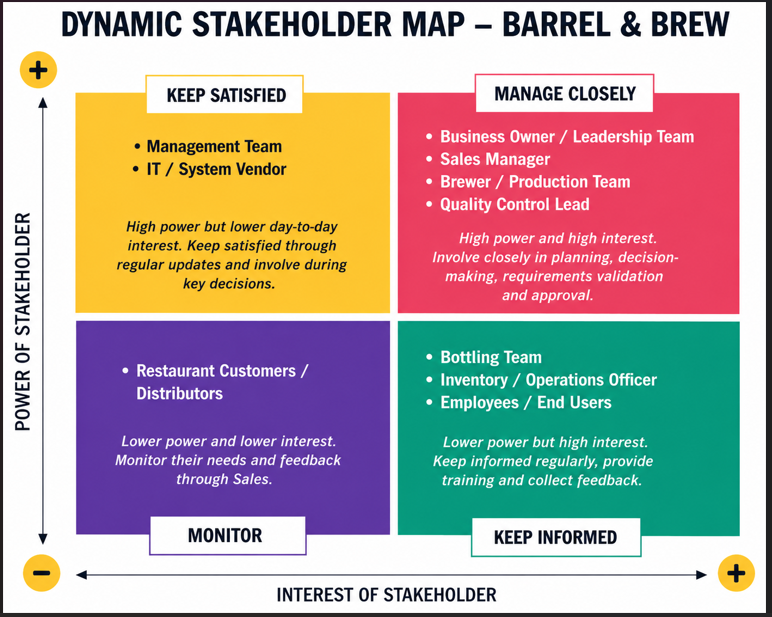

# Barrel & Brew — BRD, Gap Analysis & Process Mapping

**Case study:** Barrel & Brew, a family-owned craft brewery (about 10 years in business)
**Project type:** Business Analysis Capstone — Business Requirements Document (BRD), gap analysis, and process mapping
**Tools:** BRD template, draw.io (process maps and swimlanes), fishbone diagram
**Status note:** A case-study proposal. Targets are proposed, and no implementation results are claimed.

## Business context
Barrel & Brew's small-batch products are now stocked in 500+ local restaurants. The surge in demand exposed weaknesses across production planning, inventory, quality control, staff workload, equipment, and communication between teams.

## Problem
- **Production delays:** weekly production targets are routinely missed, so popular products are out of stock for days
- **Quality inconsistency:** batches vary in taste, and two entire batches had to be discarded
- **Staff pressure:** overtime is up 30%, and a key brewer resigned citing unmanageable pressure
- **Manual processes:** recipes, ingredient stock, and fermentation progress live in handwritten notebooks and an out-of-date shared spreadsheet
- **Guesswork forecasting:** the Sales Manager estimates demand by intuition, with no formal tracking of distributor sales
- **Outdated equipment:** the bottling line jams often, and each jam can halt production for an hour or more
- **Communication gaps:** Sales promises batches to customers without checking with Production

## Approach
- **Stakeholder analysis and power-interest map:** 9 stakeholder groups, from the Business Owner to restaurant customers and distributors
- **Current-state (AS-IS) process map:** 15 steps from demand estimate to customer order, showing every manual handoff and breakdown
- **Gap analysis:** 10 business areas (forecasting, production planning, recipes, inventory, fermentation tracking, quality control, bottling, communication, staff workload, reporting), each with current state, desired state, gap, and proposed action
- **Fishbone diagram:** categorizes the root causes under the six future-state goals (reliable production, high quality, empowered staff, streamlined operations, data-driven decisions, modern infrastructure)
- **Future-state (TO-BE) swimlane diagram:** 16 steps across 5 swimlanes (Sales Manager, Brewer/Production, Quality Control, Bottling/Sales, Management), with system-driven checks, approval gates, and automated status updates
- **Business Requirements Document:** 38 functional requirements across 9 areas, 8 non-functional requirements, 7 business rules, 8 success metrics, recommendations, and a stakeholder sign-off page
- **Leadership presentation:** a 13-slide briefing covering the gaps, solution, requirements, projected benefits, stakeholder register, and next steps

## Proposed solution
A **Brewery Operations Management System** that links sales demand, production planning, recipe management, fermentation tracking, quality control, bottling, inventory, and reporting into one source of truth. Key rules built into the design:
- Production requests are reviewed before brewing starts
- Brewing follows an approved recipe version
- A batch must pass QC before bottling begins
- Finished-goods stock updates automatically after bottling
- Sales must confirm available stock before committing to a customer

## Requirements at a glance
| Area | Requirement IDs | Examples |
|---|---|---|
| Demand forecasting | FR01–FR04 | Capture weekly sales data, generate forecasts, compare forecast against actual |
| Production planning | FR05–FR09 | Submit and approve requests, check ingredients and capacity, assign batch IDs |
| Recipe management | FR10–FR13 | Digital recipes with version history and edit control |
| Fermentation tracking | FR14–FR16 | Digital log, batch status from brewing to ready for bottling |
| Quality control | FR17–FR20 | Digital QC checklist, no bottling before QC approval, record rejections |
| Bottling | FR21–FR24 | Notify team, record quantity and downtime, update finished goods |
| Inventory | FR25–FR29 | Track ingredients, show available vs reserved stock, low-stock alerts |
| Sales availability | FR30–FR32 | Check stock before confirming orders, reserve stock, block over-commitment |
| Reporting | FR33–FR38 | Target vs actual output, rejection rate, bottling downtime, forecast accuracy |

## Success metrics and projected benefits
- Reduce production delays by **50%**
- **100% real-time** inventory updates, closing the gap between system and physical stock
- Reduce avoidable overtime by **30%**
- Lower batch rejection rate, bottling downtime, and customer complaints, and improve forecast accuracy and on-time order fulfilment

*These are proposed targets from the case-study BRD, not achieved results.*

## Recommendation
Implement the system in phases, starting with demand forecasting, production planning, inventory, and QC. Train all users before go-live, clean the existing recipe, inventory, and sales data before migration, track KPIs after launch, and set up a preventive maintenance plan for the bottling line.

## Process diagrams
**Current process (AS-IS)** — manual forecasting, handwritten recipes, bottling jams, and no stock check before orders.

**Future process (TO-BE)** — system-supported forecasting, approval, QC, bottling, and inventory.

**Stakeholder map**

## Skills demonstrated
Business Requirements Document (BRD) authoring · gap analysis · fishbone (root cause) analysis · stakeholder mapping · AS-IS/TO-BE process mapping and swimlane design (draw.io) · functional and non-functional requirements · business rules · success metrics · stakeholder presentation

## Files
- [Barrel_and_Brew_BRD_Ikea_Onyinyechi_Anita.docx](./Barrel_and_Brew_BRD_Ikea_Onyinyechi_Anita.docx) — full Business Requirements Document
- [BarrelBrew_Presentation_Ikea_Onyinyechi.pdf](./BarrelBrew_Presentation_Ikea_Onyinyechi.pdf) — leadership presentation (PDF)
- [BarrelBrew_Presentation_Ikea_Onyinyechi.pptx](./BarrelBrew_Presentation_Ikea_Onyinyechi.pptx) — leadership presentation (editable)
- [Barrel_and_Brew_Process_Maps.drawio](./Barrel_and_Brew_Process_Maps.drawio) — editable current-state and future-state diagrams (open at [app.diagrams.net](https://app.diagrams.net))
